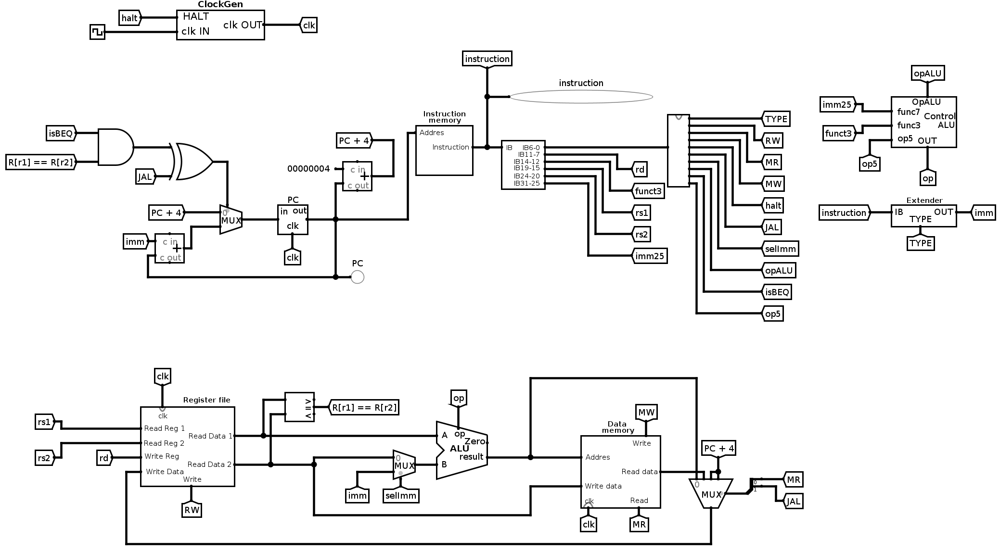

# RISC-V Single-Cycle Processor (Logisim)

A single-cycle processor for a subset of the RISC-V RV32I instruction set, built in Logisim as part of the *Computer Technology* course (1st year, Double Degree in Computer Engineering and Mathematics, University of Málaga, 2025/26).

## Context and authorship

This was a guided lab assignment that every first-year student in the course completed. The course provided the building blocks in the `RISCVlib.circ` library: ALU, register file, instruction and data memories, immediate extender, ALU control, program counter and clock generator (`ClockGen`).

My work:

- Assembling the full datapath from those components: next-PC logic, instruction fetch and decoding, register file, ALU, data memory and write-back.
- Designing the **main control unit** as a ROM indexed by the opcode, which produces every control signal in a single lookup (see [docs/control-unit.md](docs/control-unit.md)).
- Resolving `beq` with a dedicated 32-bit comparator instead of the ALU's Zero output, which is the approach the lab guide suggests.
- Writing and running the test program in [programs/](programs/).

## Supported instructions

| Type | Instructions | Notes |
|------|--------------|-------|
| R-type (ALU) | `add`, `sub`, `and`, `or`, `slt` | Register–register operations |
| I-type (ALUI) | `addi`, `andi`, `ori`, `slti` | Register–immediate operations |
| Load / store | `lw`, `sw` | Word access only |
| Branch | `beq` | PC-relative; equality checked by a dedicated comparator |
| Jump | `jal` | Writes the return address (PC + 4) to `rd` |
| Control | `halt` | Not a RISC-V instruction. Opcode `1111111` (e.g. `0x0000007f` or `0xffffffff`). It stops the clock through `ClockGen` and writes no register or memory. |

Other `funct3`/`funct7` combinations (e.g. `xor`, `sll`) and other opcodes (e.g. `jalr`, `bne`, `lui`) are not supported. An unsupported opcode reads an all-zero word from the control ROM, so it writes nothing to registers or memory.

## Datapath



- **Next PC:** a multiplexer chooses between `PC + 4` and `PC + imm`. It selects `PC + imm` when `(isBEQ AND R[rs1] == R[rs2]) XOR JAL`, so one adder computes the target for both `beq` and `jal`.
- **ALU operand B:** `selImm` chooses between the register `rs2` and the extended immediate.
- **Write-back:** a 3-input multiplexer selected by `{JAL, MR}` writes back the ALU result (`00`), the data read from memory (`01`) or `PC + 4` (`10`).

## Repository structure

```
circuits/   Logisim files: the processor, the course component library, and the memory images loaded on reset
programs/   Test program (assembly source and memory images)
docs/       Control unit design and screenshots
```

## How to run

1. Requirements: Java and the **Logisim 2.7.1 build with the DAC patch** (`logisim-generic-2.7.1-dac1.2.5.RV`), which the course distributes. It is not included here. The circuit uses features of this build, such as memories that load `instmem.txt` and `datamem.txt` on reset. It has not been tested in standard Logisim or Logisim-evolution.
2. Open `circuits/VeryHardWareRISCV.circ`. Keep `RISCVlib.circ`, `instmem.txt` and `datamem.txt` in the same folder: the processor loads the library by relative path, and the memories load the two text files.
3. To run a different program, copy its `instmem.txt` and `datamem.txt` into `circuits/`. Then use *Simulate → Reset Simulation* to reload the memories.
4. Enable *Simulate → Ticks Enabled*. The processor runs until it reaches `halt`. Each clock cycle lasts 16 ticks (8 high and 8 low), long enough to cover the delays the course library models for the memories, ALU and register file.

## Testing

I simulated the following programs and checked the data memory after `halt`:

| Program | Data | Expected | Result |
|---------|------|----------|--------|
| SAD — sum of absolute differences of two vectors ([programs/sad](programs/sad/)) | Lab example, n = 4 | 8 | `RAM[0xC] = 8` after 72 cycles |
| SAD | Data from the `.data` section of `sad.s`, n = 5 | 10 | `RAM[0xC] = 10` after 88 cycles |
| Lab test for ALU/ALUI instructions (course material, not included) | Lab data | `0x7af` | `RAM[0] = 0x7af` |
| Lab test for `beq` (array-sum loop, course material, not included) | Lab data | 4 | `RAM[0] = 4` |

## Possible extensions

- Add a top-level `halt` output pin and a script that runs every test program headless with the course's Logisim command-line mode (`-tty`) and checks the results automatically.
- Support more RV32I instructions (`bne`, `lui`, `jalr`). The extender already supports U-type immediates.
- Turn it into a 5-stage pipeline with hazard detection.

## License

The processor circuit (`VeryHardWareRISCV.circ`) and the test program are my own work. `RISCVlib.circ` was written by the course staff and is included **[PENDING: only with the lecturer's permission; otherwise remove it and replace this sentence with: "`RISCVlib.circ` belongs to the course staff and is not redistributed here; the processor needs it in `circuits/` to open."]**
