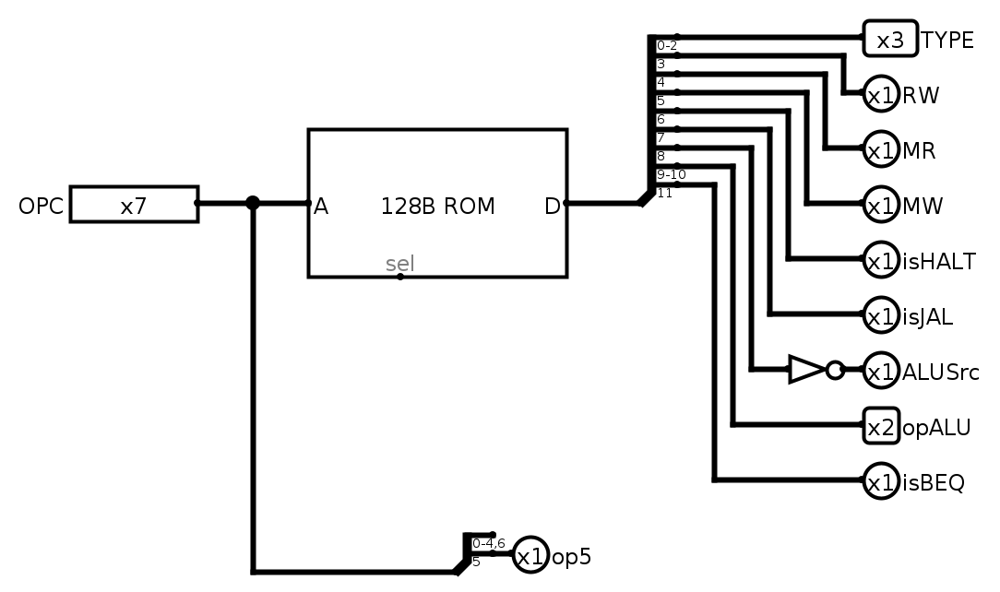

# Main control unit

## Approach

The control unit is a **ROM with 128 words of 12 bits, addressed directly by the 7-bit opcode**. Each word stores every control signal for that opcode, and a splitter distributes the 12 bits to the outputs. The control unit is therefore a lookup table:

- Decoding an instruction is a single ROM read; there is no per-signal gate logic.
- Supporting a new opcode means writing one more ROM word, plus whatever datapath changes the instruction needs.
- Opcodes that are not used read as `0x000`, which disables register and memory writes, so an unknown instruction has no effect on the processor state.

**[PENDING: one sentence on what the lab guide or slides suggested for the control unit (e.g. gate-level decoding per signal), so the difference is explicit.]**

**[PENDING: why you chose this approach, in your own words.]**

`op5` is not stored in the ROM. It is bit 5 of the opcode, passed directly to the course-provided ALU control, which requires it to tell R-type from I-type.

### Branch resolution

The lab guide suggests checking `beq` by subtracting in the ALU and using its Zero output. In this design, `beq` is resolved by a separate 32-bit comparator connected to the two register-file outputs:

- The ALU is not involved in `beq`, so `ALUSrc` and `opALU` are don't-cares for it.
- The trade-off is one extra comparator in the datapath.

## ROM word layout

| Bits | Signal | Meaning |
|------|--------|---------|
| 2–0 | `TYPE` | Immediate format for the extender: `000` I, `001` S, `010` B, `011` U, `100` J |
| 3 | `RW` | Register write |
| 4 | `MR` | Memory read; also bit 0 of the write-back selector |
| 5 | `MW` | Memory write |
| 6 | `isHALT` | Stops the clock (via `ClockGen`) |
| 7 | `isJAL` | Jump; also bit 1 of the write-back selector |
| 8 | R-type flag | Inverted to produce `ALUSrc` (`selImm` in the datapath) |
| 10–9 | `opALU` | ALU control: `00` add, `01` subtract, `10` determined by `funct3`/`funct7` |
| 11 | `isBEQ` | Conditional branch |

## Control signals

`X` means "don't care": the signal has no effect on that instruction.

| Instruction | Opcode | ROM word | TYPE | RW | MR | MW | isHALT | isJAL | ALUSrc | opALU | isBEQ |
|-------------|--------|----------|------|----|----|----|--------|-------|--------|-------|-------|
| R-type      | `0110011` | `0x508` | X (`000`) | 1 | 0 | 0 | 0 | 0 | 0 | `10` | 0 |
| I-type ALU  | `0010011` | `0x408` | `000` (I) | 1 | 0 | 0 | 0 | 0 | 1 | `10` | 0 |
| `lw`        | `0000011` | `0x018` | `000` (I) | 1 | 1 | 0 | 0 | 0 | 1 | `00` | 0 |
| `sw`        | `0100011` | `0x021` | `001` (S) | 0 | 0 | 1 | 0 | 0 | 1 | `00` | 0 |
| `beq`       | `1100011` | `0x802` | `010` (B) | 0 | 0 | 0 | 0 | 0 | X | X | 1 |
| `jal`       | `1101111` | `0x08c` | `100` (J) | 1 | 0 | 0 | 0 | 1 | X | X | 0 |
| `halt`      | `1111111` | `0x040` | X | 0 | 0 | 0 | 1 | 0 | X | X | 0 |

The values in parentheses are the ones actually stored for don't-care fields.

## Mapping to textbook signal names

| This design | Textbook name |
|-------------|---------------|
| `RW` | RegWrite |
| `MR` | MemRead (and MemToReg) |
| `MW` | MemWrite |
| `ALUSrc` / `selImm` | ALUSrc |
| `opALU` | ALUOp |
| `isBEQ` | Branch |
| `isJAL` | Jump |
| `{isJAL, MR}` | Write-back selector: `00` ALU result, `01` memory data, `10` PC + 4 |
